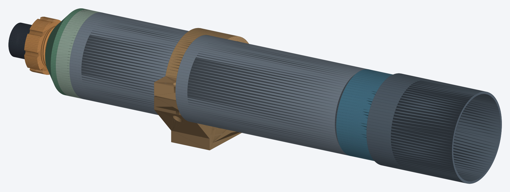
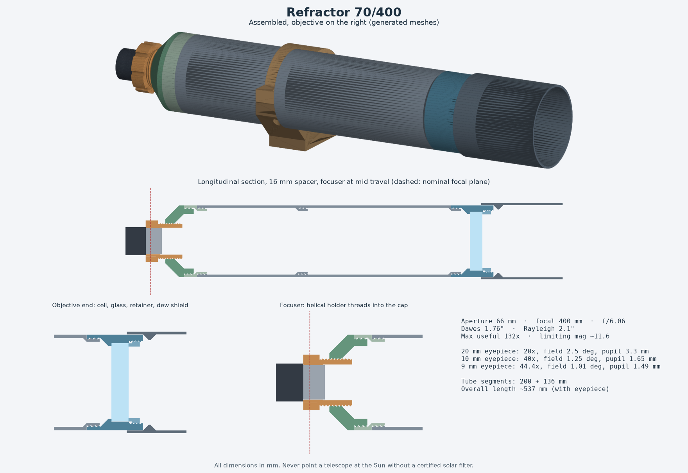
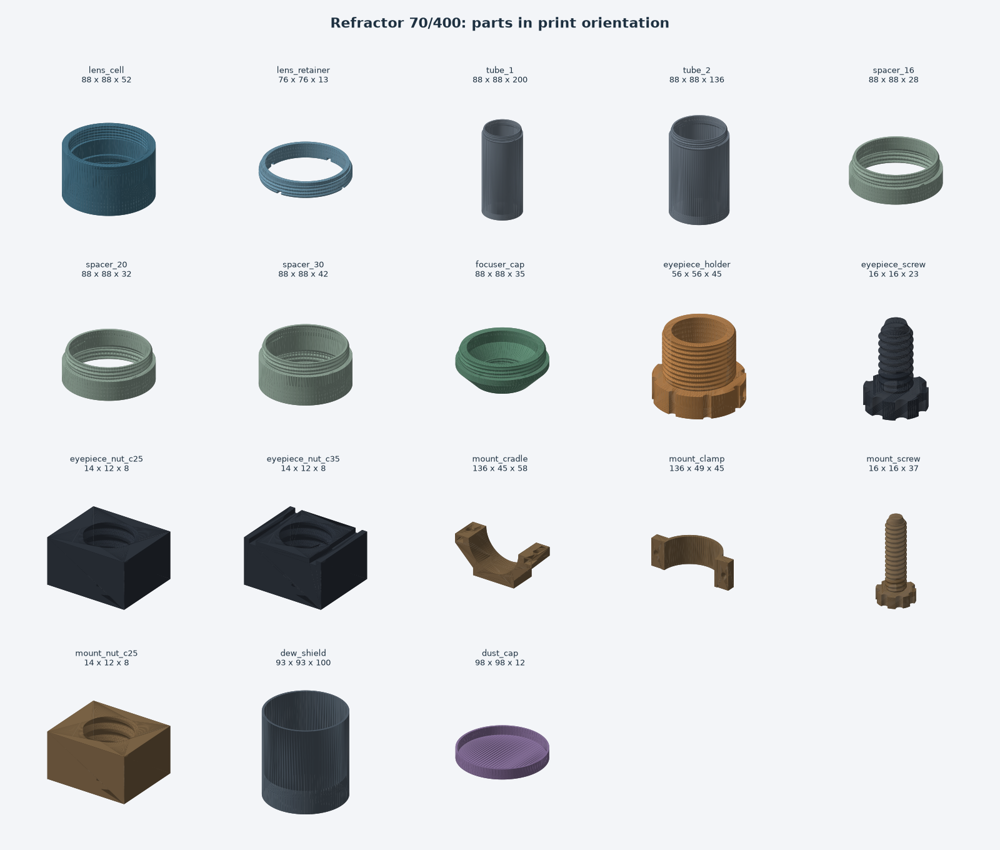

# telescope-generator

Measure your lens and eyepiece, and get a 3D-printable refractor telescope (STL files) that fits them.



> **Safety: never point a telescope (or a loose lens) at the Sun without a proper, certified solar filter mounted over the front of the objective.** Looking at the Sun through any optical instrument causes permanent eye damage in an instant. Eyepiece "sun filters" are not safe.

Workflow: print fit-test gauges, write the measurements that fit into a JSON file, and generate every part from it.

Verification status:

- The `examples/refractor-70-400.json` design has been printed, assembled and tested (tube lengths, threads, cell and focuser; the dew shield and dust cap are not yet printed).
- Any other config is verified **digitally only**: every mesh is checked to be watertight and a single body, the threaded pairs pass collision tests, and the design passes the dimension checks listed below. `examples/refractor-80-600.json` is an illustrative, **unverified** example.

## Features

- **Config with validation**: lens aperture, focal length, the gauge size that fitted (or a caliper reading plus clearance), edge thickness, eyepiece barrel and bore, focuser travel, tube wall, printer size, tripod screw. Impossible or inconsistent configs are refused with a list of clear errors.
- **`gauges`**: fit-test rings and bushings around your nominal diameters, thread test sets with three clearances, and printed 1/4"-20 tripod nuts. Print these first.
- **`build`**: every part as STL, packed onto print plates, plus `summary.md` / `summary.json` with optics, focus margins, part list and checks.
  - lens cell with threaded retainer ring
  - tube split into printable segments joined by printed threads
  - focus spacers (16 / 20 / 30 mm by default, stackable) to correct the tube length after a focus test
  - helical focuser: the eyepiece holder screws into the rear cap (18 mm travel by default), with a printed thumb screw and nut holding the eyepiece
  - dew shield and slip-on dust cap
  - tube cradle and clamp with a flat foot for a photo tripod head: either a printed 1/4"-20 thread (as in the original) or a pocket for a 1/4"-20 hex nut
- **`preview`**: PNG renders of the assembled telescope, a longitudinal section and every part.
- **Optics summary**: magnification, exit pupil and true field per eyepiece, f-ratio, Dawes and Rayleigh limits, useful magnification range, limiting magnitude.

| Assembly and section | Parts (print orientation) |
|---|---|
|  |  |

## Install and usage

Requires Python 3.11+ and [uv](https://docs.astral.sh/uv/).

```sh
git clone https://github.com/PSCactux/telescope-generator.git && cd telescope-generator
uv sync

uv run telescope-generator validate examples/refractor-70-400.json
uv run telescope-generator gauges   examples/refractor-70-400.json --out gauges --preview
uv run telescope-generator build    examples/refractor-70-400.json --out out
uv run telescope-generator preview  examples/refractor-70-400.json --out out
```

`build` writes `out/parts/*.stl` (one file per part), `out/plates/plate_XX.stl` (parts laid out for your bed) and `out/summary.md`. Add `--check-threads` to also run the thread collision tests (about 15 s). A sample summary is in [docs/summary-70-400.md](docs/summary-70-400.md).

Run the tests with `uv run pytest`.

## Measurement guide

Start from a copy of `examples/refractor-70-400.json`. All lengths are in millimetres.

**1. From the seller or the lens itself** (nominal values are fine):

| Key | What |
|---|---|
| `objective.clear_aperture` | lens aperture, e.g. 70 |
| `objective.focal_length` | focal length, e.g. 400. Corrected later by the focus test |
| `eyepieces[]` | focal length and apparent field of each eyepiece (50 deg if unknown) |
| `eyepiece_holder.barrel_diameter` | 31.75 for 1.25" eyepieces |

**2. With a ruler or caliper**:

| Key | What |
|---|---|
| `objective.edge_thickness` | thickness of the whole objective at its edge. If it is a doublet, measure both lenses together, in their original order and spacing. Do not separate or flip them |
| `objective.measured_diameter` | diameter of the glass (or of its metal cell if it came in one), only as a starting point for the gauges |
| `eyepiece_holder.insertion_length` | length of the eyepiece barrel from its tip to the shoulder of the wider body |

**3. Print the gauges and use the ones that fit** (more reliable than a caliper, because they include how your printer and filament behave):

```sh
uv run telescope-generator gauges my-telescope.json --out gauges --preview
```

- **L rings** (2 mm tall, around the expected lens diameter): with the lens lying flat on a soft cloth, lower each ring around its edge, starting with the largest. Pick the smallest one that passes all the way around the edge **without pressure** and with a little play. Never force it or let the ring hold the glass. Write its bore into `objective.gauge_fit_diameter` (it overrides `measured_diameter`). If none fit, change `measured_diameter` and print another series (`--lens-step`, `--lens-count`).
- **O bushings** (16 mm tall): slide the metal barrel of the eyepiece in. Pick the smallest that slides by hand with the least wobble and write it into `eyepiece_holder.gauge_fit_bore`.
- **T and F thread sets** (one male, three females marked 0.15 / 0.25 / 0.35): screw each female onto the male a few times. Pick the smallest clearance that turns smoothly without binding and write it into `fit.thread_clearance`. 0.25 mm is a good starting point for PETG. The T thread size depends on the lens diameter, so print these after you have chosen the L ring.
- **P nuts** (only for `tripod.mode: "printed_thread"`): try them on your tripod screw and write the best one into `tripod.thread_clearance`. If you prefer a metal hex nut, use `"nut_pocket"` instead.

**4. Focus test before printing the tubes.** Print the lens cell, retainer, focuser cap and eyepiece holder first. In daylight, point at something more than 200 m away (**never at or near the Sun**), hold the eyepiece behind the cell and move it until the image is sharp. `summary.md` gives the expected distance from the rear face of the cell to the eyepiece shoulder (375 mm for the 70/400). If you measure a different distance, add the difference to `objective.focal_length` and rebuild. The spacers and the focuser travel absorb the rest.

Also set `printer` (bed size and maximum height) and `tube.max_segment_length` (tubes print standing up).

## How it works

**Parametric CSG.** Every part is built in [manifold3d](https://github.com/elalish/manifold) from cylinders, cones and boxes with boolean operations, which guarantees manifold output. Threads are not booleans of helices: each thread is generated directly as a closed triangle mesh with an explicit helical surface (a single-start trapezoidal profile of our own, not ISO). Female threads are cut with the same generator, inflated by the radial clearance. Each part is converted to a trimesh and rejected if it is not watertight, has inconsistent winding, has more than one body or does not sit on z = 0.

**Geometry from the printed v1.** The part shapes are the ones of the working 70/400. Each of its fixed numbers is expressed relative to the measurements: tube thread root = lens bore / 2 + 3.475 mm, retainer thread root = lens bore / 2 + 1.075 mm, tube outer radius = thread major radius + wall, focuser thread from the eyepiece bore, and so on. So the 70/400 config gives back 88 mm tubes with 82 mm threads, a 52 mm cell, a 45.2 mm cap opening and 200 + 136 mm segments, as printed.

**Tolerance and fit strategy.**
- Diameters that touch glass or metal come from printed gauges, not from the caliper. The gauges are printed with the same machine, filament and profile as the final parts.
- Clearance is always applied radially, and only on the female side. Threads use the clearance chosen with the thread gauges (0.25 mm by default). The spare eyepiece nut gets +0.1 mm.
- Every part has a flat print face and no overhang steeper than 45 degrees: females and flat faces go down, males go up. Bores get a small elephant-foot relief at the bed and a lead-in chamfer.
- Glass is never clamped by plastic directly. It sits on a ledge, and the retainer has a nose that presses its edge through a soft ring.

**Optical layout.** z = 0 is the rear face of the cell. The focal plane sits at `lens_mid - focal_length`, where `lens_mid` is the middle of the glass in its pocket. The eyepiece shoulder (the holder mouth) goes `field_stop_depth` behind that, and the holder is placed at mid travel. Working back, this fixes the cap position and the total tube length. The tube is split into segments no longer than `max_segment_length`, assuming the first spacer is fitted. A check verifies that the focal plane falls inside the focuser travel once the segments are rounded. Another checks that the light bundle clears the narrowest opening.

**Optics formulas** (D = effective aperture in mm, F = focal length, f = eyepiece focal length):
magnification `F / f`, f-ratio `F / D`, exit pupil `D / M`, true field `apparent field / M`, Dawes limit `116 / D` arcsec, Rayleigh limit `1.22 λ / D` with λ = 550 nm (`138 / D` arcsec), useful magnification `D / 7` to `2 D`, limiting magnitude `7.5 + 5 log10(D in cm)`, light grasp `(D / 7)^2`. The effective aperture is the smallest of the lens aperture, the ledge opening and the retainer opening. The original v1 stops the 70 mm lens down to 66 mm. Lower `objective.shelf_width` to recover some of it.

## Printing notes

- Proven settings: PETG, 0.4 mm nozzle, 0.20 mm layers, 2 wall loops, 20 % infill, no supports, no brim. Use the same profile for the gauges and the final parts.
- Import at 100 %, do not scale, and do not add XY compensation to fix a fit. Pick a different gauge instead.
- Parts are exported in print orientation. Tubes print standing up, one per plate (parts taller than 120 mm get their own plate). The original 70/400 v1 took about 19 hours and 550 g of PETG (without the dew shield and dust cap).
- Print order: gauges, then cell + retainer + cap + eyepiece holder, then the focus test, then tubes, spacers and mount.
- Assembly: put a soft ring (felt, paper or painter's tape) on the ledge, then the objective in its original orientation, then another soft ring, then screw in the retainer only until the glass does not rattle. Screw the front tube into the cell, then the rest of the tubes, the spacer and the cap. The eyepiece holder screws into the cap, and turning it focuses. Clamp the cradle near the balance point and screw the foot onto the tripod head.
- Threads are right-handed. Turn by hand, without tools or lubricant.

## Project structure

```
src/telescope_generator/
  config.py     JSON -> dataclasses, range and cross validation
  optics.py     optics formulas
  geometry.py   manifold3d primitives, helical threads, mesh checks
  refractor.py  derived dimensions, sanity checks and every part
  gauges.py     fit-test rings, bushings, thread sets, tripod nuts
  layout.py     packing parts onto print plates
  build.py      build pipeline and summaries
  preview.py    matplotlib renders
  cli.py        telescope-generator command
examples/       refractor-70-400.json (printed and tested), refractor-80-600.json (unverified)
tests/          pytest suite
docs/           renders and a sample summary
```

## Limitations and future work

- Only refractors. A Newtonian reflector (114/900) was designed and checked in the original project but is not printed yet and is not generalized here. It is future work.
- The focal plane position depends on the eyepiece field stop, which is an assumption (6 mm inside the barrel). Do the focus test.
- Designed around 1.25" eyepieces and lenses of about 55 mm and up. Smaller lenses are refused because the tube would be narrower than the focuser. 2" barrels are accepted by the config but untested.
- The mount is a simple cradle for a photo tripod head. There is no slow-motion control.
- The renders use matplotlib, so the 3D views can show painter's-algorithm artifacts.

## License

MIT, see [LICENSE](LICENSE).
